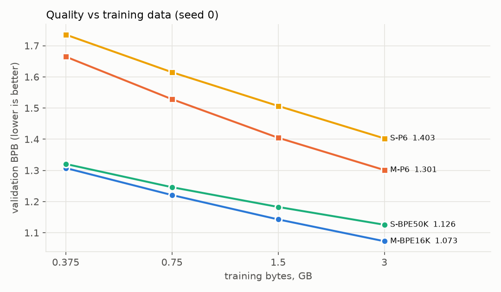
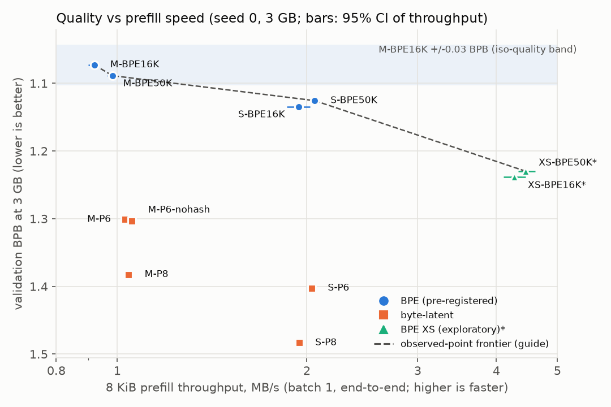
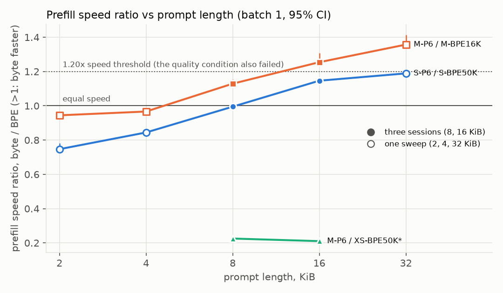

# BLT 式字节潜在模型能否在不过度失真的前提下比 BPE 更快？

**受控研究报告**（计划为两周，2026‑11‑08 至 11‑22；主要测量于 11‑12 完成。RTX 4070 12GB 单卡）

> 执行与撰写：Claude（Anthropic）。研究目标、范围删减等关键决定由研究负责人作出。代码主要由 GPT‑6.1 Terra 编写、Claude 审查；各阶段结果和本报告经 GPT‑6.1 Sol 审阅（第 7–20 轮）。Sol 的意见只作参考，凡采纳的都经 Claude 独立核实。
> 预注册计划：`docs/preregistration.md`（2026‑11‑08 冻结）。逐日实验记录和审阅讨论原文没有收入本仓库。本报告只引用实际训练出的检查点，不外推曲线，不用 FLOPs 代替墙钟时间。

---

## 简版（给非专业读者）

**结论：在我们这个规模（约 800 万–1.1 亿参数、每个模型训练 3GB 文本）上，测试的字节潜在模型没能做到"又快又不失真"。预先定好的主要判定全部不通过。**

- **它预测得更差。** 主对比的两个模型用同样的全局主干、同样的数据，字节模型的预测损失每字节多约 0.23 bit（越低越好）。换随机种子、换测试集都一样。
- **它读长文快一点，但不够，也不划算。** 读入 8–16 KiB 的提示时，字节模型的速度是同主干 BPE 的 1.1–1.3 倍，8 KiB 时没到预定的 1.2 倍。一个小得多的 BPE 模型质量比它好，读入还快 2–5 倍。
- **它写字更慢。** 生成 256 字节，一次一条时用时约 1.7 倍，一次 8 条时约 2.7 倍。
- **它在我们的"找回数字"测试上表现很差。** 文中藏一个 5 位随机数，让模型从 10 个候选里挑：同主干的 BPE 在 4 KiB 内几乎全对，字节模型接近瞎猜。
- **现成的大模型也慢。** 公开的字节模型 Bolmo‑1B 质量很好，但读入长提示比同代的 OLMo‑1B 慢约 2.2–2.7 倍。预先定的粗略估算不支持继续投入"削薄 Bolmo"的方案，所以没有做。

这些结论只针对我们的实现、训练量和硬件，不是对字节潜在模型的一般否定，也没有查明质量差距的来源。

---

## 1. 研究问题与预注册标准

**核心问题**：在相同的留出 BPB（相差 ≤0.03 bit/字节，且相对 ≤3%）和可接受的任务表现下，字节潜在模型的实测推理性能是否优于我们训练出的最强 BPE 模型？允许否定答案。

预注册的判定（`docs/preregistration.md` §5 的缩写；完整条件见原文。测试集只在模型选择冻结后打开一次）：

| 优先级 | 主张 | 通过条件（缩写） |
|---|---|---|
| 主 | 等质量下 prefill 更快 | ΔBPB ≤0.03 且 ≤3%；8 和 16 KiB 下都 ≥1.20 倍，且计时区间不含 1；有重复 |
| 主 | 任务保持 | PIQA + HellaSwag 合计降幅 ≤2 分；达不到能力门槛时不支持 |
| 次 | 批量解码更快 | batch 8 下 ≥1.20 倍（细节后来补定，见 §3.3） |
| 次 | batch‑1 延迟 | ≥1.10 倍 |
| 次 | 更长的可用上下文 | 同等物理缓存多装 ≥1.25 倍字节，检索 ≥90%，降幅 ≤5 分 |
| 次 | 内部表示 | 两个属性受控提升 ≥3 分并重复；无害扰动下超额 NLL 低 ≥20%，且对数字改动仍敏感 |
| 次 | Thin‑Bolmo / WSP 初始化 | 与教师差距 ≤0.03 BPB；编程初始化少用 ≥25% 恢复数据。研究负责人 11/11 改为：Track A 的速度估计 ≥1.20 倍才执行 |
| 次 | 路由编程（A2） | P 匹配时 BPB 改善 ≥0.01，哨兵不退化 |

## 2. 做了什么

### 2.1 模型
所有模型的全局主干用同一个 transformer block 实现（RMSNorm、SwiGLU、RoPE、4 个 KV 头的 GQA、SDPA、静态 KV 缓存）。字节模型另有局部编码器和解码器、池化投影和哈希 n‑gram 表；P8 模型的全局主干更深。

| 模型 | 全局主干（层/宽） | 总参数 | 每个全局位置的平均字节数（验证集） |
|---|---|---|---|
| XS‑BPE50K / 16K（探索性，后加） | 4 / 256 | 16.3M / 7.6M | 4.61 / 4.29 |
| S‑BPE50K / 16K | 6 / 512 | 44.6M / 27.3M | 4.61 / 4.29 |
| S‑P6 / S‑P8 | 6 / 512、8 / 512 | 44.9M / 51.2M | 5.92 / 7.73 |
| M‑BPE50K / 16K | 9 / 768 | 95.2M / 69.2M | 4.61 / 4.29 |
| M‑P6 / M‑P8 | 9 / 768、11 / 768 | 96.1M / 108.7M | 5.92 / 7.73 |
| M‑P6‑nohash（消融） | 9 / 768 | 约 58.4M（M‑P6 减去 6×8192×768 的哈希表） | 5.92 |

- **字节模型**：局部编码 1 层、解码 2 层（宽 128/192），64 字节块内因果注意力；在已观察到的空格或标点之后切 patch（严格因果），最短长度标定到 P≈6 或 8，最长 16 字节；取 patch 末状态投影到全局宽度，加 6 张哈希 n‑gram 表（n=3..8，每张 8192 行）。
- **P8 模型的主干更深**，把省下的计算投回主干，所以它是前沿上的一个点，不是干净的 patch 大小消融。

### 2.2 数据与训练
- FineWeb‑Edu sample‑10BT，物化为不可变的字节分片（训练 10.0GB，验证、测试各 16MiB，按文档切分，不重叠，记录哈希）。
- 分词器：50K 用 GPT‑2 原版；16K 用同样的字节级预处理，在训练集的 200MB 固定样本上训练一次，S、M 共用。
- 每个模型训练 3GB，所有模型用相同顺序的 8KiB 窗口。AdamW；学习率按预注册的筛选和确认规则逐个选定。
- 重复：M‑P6 与 M‑BPE16K 各训了第二个种子。
- BPB = 文本目标的总 NLL ÷（ln2 × 实际计分的 UTF‑8 字节数），两族同一口径。

### 2.3 相对计划的改动（都记录在实验日志中）
- **研究负责人批准删减**（11/11 10:45）：删去共同续训和推测解码/MBP；Thin‑Bolmo 改为以 Track A 的速度估计 ≥1.20 倍为闸门。
- **探索性补充**（看到预注册结果之后加的，下文都标出）：XS 小 BPE 对照；C1 全局直连读出、冻结读出、解码器容量续训等诊断；事后的去哈希探针；检索评分审计。
- **后来补定或修改的测量协议**：解码的 batch、长度和对照方式是在看过验证集和 prefill 结果之后、正式解码测量之前补定的；解码一致性检查改为容许 bf16 数值平局（在读任何解码测速数字之前定的，见 §3.3）；检索提示改为 v2 格式（在 CPU 上查看 6 个格式检查样例之后、正式 GPU 筛查之前定的）。

## 3. 结果

### 3.1 预测质量

验证集和测试集 BPB（3GB；越低越好）：

| 模型 | 验证集 | 测试集 |
|---|---|---|
| XS‑BPE50K* | 1.2297 | 1.2369 |
| XS‑BPE16K* | 1.2380 | 1.2444 |
| S‑BPE50K | 1.1255 | 1.1328 |
| S‑BPE16K | 1.1345 | 1.1410 |
| S‑P6 | 1.4025 | 1.4101 |
| S‑P8 | 1.4833 | 1.4903 |
| M‑BPE50K | 1.0886 | 1.0961 |
| **M‑BPE16K** | **1.0727** | **1.0793** |
| **M‑P6** | **1.3010** | **1.3080** |
| M‑P8 | 1.3825 | 1.3893 |
| M‑P6‑nohash | 1.3032 | 1.3113 |
| M‑BPE16K seed 1 | 1.0746 | 1.0815 |
| M‑P6 seed 1 | 1.3069 | 1.3138 |

\* 探索性对照。

- **主配对**（M‑P6 对 M‑BPE16K，测试集，按文档聚类的配对 bootstrap；负数表示字节模型更差）：seed 0 −0.2288 [−0.2332, −0.2240]，seed 1 −0.2322 [−0.2368, −0.2272]。远超 0.03 的容差。
- 差距随训练量缩小（M 规模：0.375GB 0.357 → 0.75GB 0.308 → 1.5GB 0.262 → 3GB 0.228），在实测范围内是容差的 7.6–11.9 倍。本报告不外推它何时会消失。
- **等训练时间截面**（预注册的次要视角；活跃训练 1 小时，含编译、训练中验证和存档，不含暂停）：

  | 配对 | 字节 | BPE |
  |---|---|---|
  | S‑P6 / S‑BPE50K（S‑BPE16K） | 1.4361 | 1.2572（1.2031） |
  | M‑P6 / M‑BPE16K | 1.4573 | 1.2166 |

  字节模型训练吞吐更高，但同样的训练时间下差距仍然很大。
- 最小的 XS‑BPE50K（主干 4 层、宽 256）也比质量最好的字节模型 M‑P6 好 0.071 BPB。
- 哈希通路：M‑P6 与去哈希消融只差 0.002，小于 M‑P6 两个种子之间的差（0.006）。两个模型的公共权重初始化也不同，所以这只算单次运行的观察，不是哈希的因果效应。

### 3.2 prefill 速度与质量‑速度前沿（主判定）

图中纵轴向上表示更好（BPB 更低）；横条是吞吐的 95% 区间；虚线只连接观察到的非被压点，作视觉参考。

端到端 prefill，batch 1，三轮合并（每格每轮 128 次校准/预热请求、100 次计时请求；括号为交叉 bootstrap 95% 区间；比值 >1 表示字节模型更快）：

| 配对 | 8 KiB | 16 KiB |
|---|---|---|
| M‑P6 / M‑BPE16K | 1.129 [1.123, 1.154] | 1.254 [1.235, 1.309] |
| M‑P8 / M‑BPE16K | 1.144 [1.137, 1.166] | 1.295 [1.277, 1.428] |
| S‑P6 / S‑BPE50K | 0.995 [0.985, 1.005] | 1.146 [1.133, 1.163] |
| M‑P6 / S‑BPE50K | 0.503 [0.500, 0.510] | 0.530 [0.525, 0.540] |
| M‑P6 / XS‑BPE50K* | 0.225 [0.223, 0.229] | 0.210 [0.205, 0.227] |
| S‑P6 / XS‑BPE50K* | 0.444 [0.439, 0.455] | 0.462 [0.442, 0.486] |

- **主判定：不通过。** 没有任何字节模型进入 BPE 的 0.03 BPB 等质量带。速度本身也不够：M‑P6/M‑BPE16K 在 8 KiB 只有 1.129 倍（要求 1.20）；16 KiB 过了 1.20，但这时 BPB 差 0.23。
- **前沿上，字节模型全部被压过**：预注册模型中，S‑BPE50K 在两种长度上都比 M 规模字节模型质量更好、速度更快（S‑P6 没有被压过）；加上探索性的 XS 后，XS‑BPE50K 在 8、16 KiB 下压过所有字节模型——比 M‑P6 快约 4.4–4.8 倍、比 S‑P6 快约 2.2 倍，BPB 都低 0.07 以上。
- 字节模型的速度优势随长度增大：2–4 KiB 时反而更慢（M 对 0.94–0.97，S 对 0.75–0.84），32 KiB 时 1.19–1.36（单轮）。
- **敏感性**：换一组提示（种子 1，单轮）后，比值都变高：M 对 8 KiB 1.195、16 KiB 1.293；S 对 1.055 / 1.165；XS 对 0.255 / 0.226。bootstrap 区间只覆盖同一组提示内的抽样，换一组提示和换时段的影响更大，所以两组并列报告。结论不受影响。
- 哈希表让 prefill 慢约 2–3%（M‑P6 对 M‑P6‑nohash 0.977 / 0.971）。
- 只看两边都命中 graph 缓存的请求，比值略低（M 对 16 KiB 约 1.22–1.23）；S‑P6/S‑BPE16K 16 KiB 从 1.227 降到约 1.184。测量协议见附录 A。

### 3.3 生成速度（decode）

对照方式按冻结的写法：**配对的 M‑BPE16K 在所测的非推测实现中最快的那种**（每个模型从 5 种方式中按校准提示选定）。XS 更快，推测解码已删去。设定：8 KiB 提示，每行要求 256 字节，三轮各 30 次。这些细节是正式解码测量之前补定的。

| 设定 | M‑P6 / M‑BPE16K 速度比 [95% CI] | 要求 | 判定 |
|---|---|---|---|
| batch 1 | 0.574 [0.531, 0.591] | ≥1.10 | 不通过 |
| batch 8 | 0.365 [0.334, 0.386] | ≥1.20 | 不通过 |

- **可观察到的原因**（第 1 轮的中位数，作代表）：字节模型每个字节走一步局部解码器（256 步），BPE 只要 68 步（batch 1）或 92 步（batch 8，由最慢的那一行决定）。batch 1 时字节模型单步更快（0.82 对 1.74 ms），batch 8 时两边单步几乎一样（4.19 对 4.16 ms）。另外，批里只要有一行结束 patch，全局主干就对整批计算一次，所以批量时字节模型省不下多少全局计算。现在的路由、缓存和同步批处理实现也有影响。
- 诊断格子（单轮，只作描述）：S‑P6/S‑BPE50K 8 KiB 为 0.41 / 0.30 / 0.49（batch 1/8/32）；M‑P6/XS‑BPE50K 为 0.20 / 0.07 / 0.08。batch 32 时 BPE 的扩展性很差（M‑BPE16K 8 KiB 每步约 15 ms），疑似所测同步解码器的实现局限，没有做 profile；它让 batch 32 的比值（M 对 0.89）偏向字节模型，不影响判定。
- **一致性检查的修改**：第一次运行时，字节模型在 batch 8/32 下有极少数步与参考路径选了不同的字节。诊断显示是 bf16 数值平局：两边领先幅度都在 1 个 bf16 刻度内；在 CPU 上用 FP32 重跑（生成历史因精度不同而不同），4096 次选择零差异。于是改为：两边领先幅度都 ≤4 个 bf16 刻度才算平局，平局后强制同步，平局最多占 1%。这条规则在看到一致性失败之后、读任何测速数字之前定下；第一次运行中已测完的 batch‑1 速度没有看，整轮重测。实际平局占 0.05–0.17%，BPE 为 0。它保证的是"有界、强制同步下的数值相容"，不是自由生成时逐字节完全相同。

### 3.4 常识任务（PIQA / HellaSwag）

零样本；每个候选按 NLL 除以它的 UTF‑8 字节数（含前导空格）打分，这与评测工具常用的 acc_norm 不完全相同；合计为两项准确率的等权平均（越高越好；随机水平 PIQA 50、HellaSwag 25）。

| 模型 | PIQA | HellaSwag |
|---|---|---|
| M‑BPE16K（seed 0 / 1） | 58.1 / 57.7 | 27.7 / 27.9 |
| M‑P6（seed 0 / 1） | 54.0 / 55.3 | 26.5 / 26.3 |
| S‑BPE50K | 57.3 | 27.4 |
| S‑P6 | 53.2 | 25.7 |
| XS‑BPE50K* | 55.8 | 27.2 |

- **没有一个模型达到冻结的能力门槛（HellaSwag ≥30%，最高 27.9%）**，所以"任务保持"按规则无法支持。
- 但差别存在：主配对平均分差（字节 − BPE）seed 0 −2.64 [−3.74, −1.58]，seed 1 −1.98 [−3.13, −0.88]。两个种子都没能证明降幅在 2 分以内。同规模比较时，BPE 的 PIQA 都更高。
- 全部 13 个模型的结果在 `results/tasks/summary.json`。

### 3.5 长上下文：容量与检索

**容量**（三个不同的量，不是一个区间）：
- 按验证集平均长度，字节模型每个全局位置约 5.9 字节，M‑BPE16K 每 token 约 4.3 字节，理论上同样的全局位置能多装约 1.38 倍字节。
- 一个具体请求（8 KiB 提示加生成，含局部缓存和状态）：每字节逻辑缓存 1421 对 1631 字节，约 1.15 倍。
- 本实现静态分配的物理缓存，字节模型反而更大（26.9MB 对 16.0MB），部分是因为按最坏情况分配容量。
- 没有在固定物理缓存下证明"可用上下文"更长。

**检索筛查**（文中藏一个 5 位随机数，2/4/8 KiB × 深度 0.1/0.5/0.9，每格 200 次）：

| 模型 | 10 选 1 排对的比例：2 KiB | 4 KiB | 8 KiB（深度 0.1 / 0.5 / 0.9） |
|---|---|---|---|
| M‑BPE16K | 1.00 | ≥0.995 | 0.315 / 1.00 / 1.00 |
| S‑BPE50K | 0.64–0.98 | 0.62–0.985 | 0.09 / 0.85 / 0.995 |
| M‑P6 | 0.11–0.15 | 0.10–0.15 | 0.085 / 0.10 / 0.12 |
| S‑P6 | 0.10–0.11 | 0.10–0.12 | 0.085 / 0.105 / 0.115 |
| M‑P6‑nohash | 0.09–0.14 | 0.10–0.155 | 0.075 / 0.105 / 0.12 |

随机水平是 0.10。

- **预注册判定：不通过**（要求 8 KiB 每个深度直接生成的完全正确率 ≥0.90）。直接生成几乎都是 0（这些是未经指令微调的基础模型，会接着写普通文字），唯一例外是 M‑BPE16K 在 8 KiB、深度 0.9 的 0.46。所以按规则**不做长上下文续训**。
- **字节模型在这项 5 位随机数测试上很差**，接近随机，连只隔 256 字节时也只有 0.05–0.175（BPE 1.0）。为排除评分错误，做了两项独立检查（CPU FP32）：
  - 用解码路径逐字节打分，与筛查用的全前向打分相比，最大差 2.5×10⁻⁵ nats；
  - 把上下文里的数从 A 换成 B，字节模型对 A、B 的偏好平均只移动 0.31 nats（20 例中 85% 方向正确），BPE 移动 27.6 nats（100%）。字节模型读到了一点信号，但它的偏好对换数的反应小得多。
  - 纯复制提示（"Key: 77596. Key: 77596. Key: 77596. Key:"）上字节模型排对 37.5%，BPE 100%，说明字节模型有一些可用的信号。
- 这只是一项合成测试，不说明字节模型不能复制任意精确内容。一个待验证的假设：在一个 patch 内，全局条件向量不变（宽 768 投影到 192），后面的数字要靠局部解码器逐字节接着生成，复制要靠全局主干的注意力把旧数字的信息带过来；BPE 的每个 token 都有自己的全局步。编码、池化、条件投影都可能是原因，没有定位。

### 3.6 内部表示

线性探针（数字大小、奇偶、词尾类别），按数值和词元不相交划分；鲁棒性看无害改动（空白、大小写）下的超额 NLL。

- **预注册判定：两个种子都不通过。** 字节模型的受控提升在三个属性上都是负的（seed 0：大小 −7.8 分、奇偶 −20.1、后缀 −1.9）；鲁棒性比值 0.86 / 0.88（要求 ≤0.80）；改变标签的数字改动只有 7 个，"对数字敏感"几乎无从判断。
- **这个受控对照对字节模型在结构上不利**：字节模型的"输入层"是局部编码器看过整个 patch 之后的状态，后缀的输入层对照已经是 100%，"提升 3 分"在数学上不可能达到。事后用去哈希模型重跑（探索性），输入层同样满分。这说明不用哈希表也足以让这些标签在全局主干之前就线性可读，不说明哈希表没有贡献。
- 末层直接比较（描述性）：后缀字节模型更好（.98 对 .71），大小相近（.88 对 .87），奇偶两边都在多数类基线（.541）附近。后缀标签是拼写上的词尾类别，不是一般的形态理解。

### 3.7 现成模型：Bolmo‑1B 对 OLMo‑2‑0425‑1B（Track A1）

- 我们验证集上的 BPB（越低越好）：Bolmo 0.694（折叠 BPB，所选布局下；4.82 字节/patch），OLMo 0.737（4.75 字节/token）。Bolmo 是在 OLMo 基础上用更多数据续训的，这不说明字节架构本身更好。
- prefill 速度（Bolmo / OLMo，8 KiB，batch 1）：原始 0.411，强制 P=4.4 / 6 / 8 时 0.377 / 0.450 / 0.465，也就是慢约 2.2–2.7 倍。
- **Thin‑Bolmo 闸门：不通过。** 预注册的粗略筛查估计 = OLMo 耗时 ÷ [Bolmo 主干耗时 + 0.154 ×（其余耗时）]，P=6、8 KiB 为 **0.987**，要求 ≥1.20。这个估计用的是一次带同步的分解测量（各项有重叠），不是严格的上限；"局部完全免费"的乐观估计是 1.26。16 KiB 无法配对（至少一个提示超过 OLMo 的 4096 位置上限）。所以没有做 Thin‑Bolmo，它从未被构建或测量。
- 测速一步在最后一个格子（16 KiB、batch 4、P=8）因整条命令超时没测到；其余 15 格完整，判定不需要缺的那一格。

### 3.8 路由编程（Track A2，权重空间编程审计）

- 设计（运行前冻结）：在 Bolmo‑1B 上不用梯度，比较三种边界路由修改在相同压缩率（P=6.0）下预填布局的 BPB：只平移阈值（对照）；Q/K 投影向对称方向插值一半（Arm W）；手写的字节对先验（空白和标点后 +1，连续数字 −1；Arm P）。所有修改都审计张量哈希，并逐一还原。只标定了预填一侧的路由。
- **结果：在我们实现的钩子和 bf16 精度下，无结论。** 三种修改都无法把压缩率调到 6.0 ±3%：压缩率在同一个阈值（约 −6.236）处跳变（对照 5.10 → 6.68，W 5.41 → 7.98，P 5.11 → 6.42）。
- 原因：Bolmo 用 bf16 计算余弦相似度，观察到的边界分数饱和、量化得很厉害（一次诊断中 8196 个位置里 1181 个概率正好为 1，388 个卡在同一个对数几率 +6.236）。我们的钩子还把所有概率为 1 的位置都当作强制边界，而在 Bolmo 里，自然饱和的输出和真正的强制位置并不相同；这把约七成边界排除在调节之外，是我们的设计缺陷。改正它、并用 FP32 重算分数，属于新的实验，本次没有做。
- 描述性观察：这一次只平移阈值、去掉约 28% 的边界（P 4.78 → 6.61），BPB 从 0.725 升到 1.750（2.4 倍）。这不说明所有阈值调整都会让损失翻倍。

### 3.9 差距在哪里：诊断

这些都是探索性的，不改变判定，也没有定位出原因。

- **局部容量**：S‑P6 的局部模块加宽到 256 后，0.75GB 时好约 0.09 BPB（其中混有不同的随机初始化）。按 8 KiB prefill 每字节的稠密乘加估算，加宽后字节模型的计算优势就消失了（与 S‑BPE50K 持平；S‑P6 原本约少 16%）。这个估算不含注意力、查表和启动开销，不等于墙钟时间。
- **解码器一侧的几项干预收益都很小**：全局状态直连输出（C1）早期好 0.016–0.022、且在缩小；冻结的线性联合读出在 3GB 时只多约 0.001；上游冻结时把解码器从 2 层加深到 4 层续训只多 0.0015。这些不能排除解码器宽度、条件投影瓶颈或联合训练的影响。
- **patch 首字节最难**：S‑P6 在 3GB 时，patch 首字节（占 17%）的 BPB 是 2.87，其余字节 1.10；首字节占总损失约 35%，且下降得更慢。

## 4. 预注册判定汇总

| 主张 | 结果 | 判定 |
|---|---|---|
| 等质量下 prefill 更快（主） | 没有等质量配对；BPB 差 0.23（两个种子，测试集确认）；8 KiB 速度也只有 1.13 倍 | **不通过** |
| 任务保持（主） | 没有模型达到能力门槛；字节模型低 2.0–2.6 分 | **按能力门槛规则无法支持** |
| 批量解码更快 | batch 8：0.365 倍 | **不通过**（协议后来补定、经修订） |
| batch‑1 延迟 | 0.574 倍 | **不通过**（同上） |
| 更长的可用上下文 | 检索筛查不通过；没有做续训和固定物理缓存下的验证 | **筛查不通过，未继续** |
| 内部表示 | 受控提升为负，鲁棒性 0.86 / 0.88 | **按操作化的测试不通过**（测试本身有明显局限） |
| Thin‑Bolmo / WSP 初始化 | 筛查估计 0.987 | **未执行**（闸门未过） |
| 路由编程（A2） | 目标压缩率在所实现的标定和精度策略下不可达 | **无结论** |

## 5. 局限与需要知道的偏差

- **规模**：我们最大的模型约 1.09 亿参数、训练 3GB；BLT 论文的 1B 消融用了约 100B 字节。结论只针对这些检查点；差距在缩小，规模更大时可能不同。
- **单机单卡**：所有计时在一台 RTX 4070 上；bootstrap 区间不代表跨天、跨机器的变化。换一组提示时比值变动 2–13%。
- **种子**：只有主配对做了两个种子；其余模型一个种子。bootstrap 区间不含训练种子带来的不确定性。
- **事后决定**（都已标出）：XS 对照、各项诊断、去哈希探针、检索审计是看到预注册结果之后加的；解码协议是后来补定的，平局规则是在一致性失败之后、测速之前定的。
- **探针设计**：受控对照对字节模型结构上不利；划分按数值和词元、不按文档；数字改动样本太少；探针提取用的是 PyTorch 默认的 bf16 归约设置，和评分、测速不同。
- **哈希消融**：有无哈希的模型初始化不同，0.002 的差别不能当作哈希的效果。
- **Track A**：闸门是预注册的粗略估计，不是 Thin‑Bolmo 的实测；16 KiB 无法配对。
- **A2**：钩子把自然饱和的边界当成强制边界（设计缺陷）；只看预填布局下的 BPB，解码侧路由没有标定。
- **解码**：所测同步批量解码器在大 batch 下效率不高（两族共用）；没有做推测解码（按 §2.3 删减）。

## 6. 资源账目（GPU 作业时间，记录加估计，未完全核对）

| 项目 | GPU 小时 | 依据 |
|---|---|---|
| 主线训练（13 个 3GB 模型，含 2 个第二种子和 2 个 XS） | 36.5 | 各 run 训练日志的活跃时间，`results/ledger-training.json` |
| 学习率筛选与确认（34 个短训练） | 8.5 | 同上 |
| 探索训练（poolbal、w256、C1） | 1.3 | 同上 |
| 最终配对 prefill 测速 | 7.5 | 日志时间戳 02:00–09:29 |
| 解码（含第一次失败的运行） | 2.1 | 日志时间戳 |
| Track A1 / A2 / 检索筛查 | 1.8 / 0.1 / 0.2 | 日志时间戳 |
| 测试集评分、任务、探针（含事后探针）、测速敏感性 | 约 1.4 | 日志时间戳 |
| 验证集评分（约 100 次，含学习率筛选）、诊断（冻结读出、解码器续训）、阶段 0 的 pilot 和测速 | 约 6.5 | 估计，没有逐项记录 |
| **合计** | **约 66** | 计划 112 + 预留 28 |

训练时间里已包含训练中的验证，没有和评分重复计算。作废和崩溃的测速（见 `results/README.md`）算在最后一行的估计里。未用的部分主要是 Thin‑Bolmo（20 小时，闸门未过）、共同续训（6 小时，按 §2.3 删减）和长上下文续训（4 小时，筛查未过）。Claude API 和 Codex 的花费不在本表内。

## 7. 结论

1. 在这项 3GB 训练研究里，测试的字节潜在设计没有达到预注册的"质量与 prefill 速度兼得"标准。质量差距（约 0.23 BPB）是更大、更普遍的障碍；主配对在 8 KiB 的速度（1.13 倍）也没达到 1.20 倍。
2. 字节模型的速度优势只在长提示的读入阶段出现（8 KiB 起），而且被更小、更好的 BPE 模型轻松超过。生成阶段它明显更慢。
3. 除了平均预测损失，字节模型在我们的合成 5 位随机数检索测试上表现很差：同主干 BPE 在 4 KiB 内几乎全对，字节模型接近随机。
4. 现成的 Bolmo‑1B 质量好，但读入长提示慢；预注册的筛查估计不支持做 Thin‑Bolmo。它的边界分数在 bf16 下高度饱和；我们做的那一次阈值修改让损失变成原来的 2.4 倍。

**可能的后续**（都没有做，需要另行决定）：更大规模或更长训练，看差距是否继续缩小；针对复制能力的设计改动；改正后的高精度 A2；计划预留的"学习路由"续训。

## 附录 A：测量方法要点

- **prefill 测速**：端到端口径（含主机端分词或切 patch、graph 重放、同步），batch 1，只算最后一个 logit。每格每轮先用 128 次请求填充并冻结 graph 缓存，再按交替顺序计时 100 次；缓存未命中的请求走 eager 并计入（两族一样）。三轮的中位吞吐比取几何平均，区间用对提示和轮次交叉重抽的 bootstrap。另有去掉主机端预处理的 GPU 常驻口径，结论相同。
- **数值设置**：bf16 autocast，关闭矩阵乘法的低精度归约（`configure_matmul_precision`），评分、任务、测速、解码相同；探针提取例外（见 §5）。
- **任务评分**：模板与 lm‑eval 类似；主指标为按 UTF‑8 字节数归一化的候选 NLL（含前导空格），次指标为未归一化；配对 item bootstrap 2000 次。
- **探针**：样例只取验证集，锚点放在字节模型自然的 patch 结束处和 16K 分词器的 token 结束处，不强制结束 patch；词元规则只用于划分。
- **冻结的分析规则**：`results/frozen-analysis.json`（含 9 个分析代码文件的哈希；11/11–11/12 的几次部署后都核对过未变）。

## 附录 B：文件与复现

- **结果**：`results/`（目录说明、收录范围和未收录的内容见 `results/README.md`）。主要文件：`main-scores/`、`test-scores/`、`final-timing/summary-end_to_end.md`（逐请求原始计时在同目录的 `raw-timing.tar.gz`）、`final-timing-seed1/`、`decode/primary/summary.md`、`tasks/summary.json`、`probes/`、`probes-posthoc/`、`longctx-screen/`（含 `diag/audit.json`）、`trackA/gate.txt`、`router/a2.json`、`ledger-training.json`、`figures/`。
- **代码**：`src/blt/`（模型、数据、评分、探针、路由）；队列任务脚本 `scripts/final_timing.sh`、`decode_timing.sh`、`task_eval.sh`、`probe_run.sh`、`trackA_run.sh`、`longctx_screen.sh`、`router_run.sh`；汇总 `scripts/diag/timing_summary.py`、`decode_summary.py`、`task_summary.py`、`trackA_gate.py`、`screen_summary.py`；图 `scripts/diag/report_figures.py`。
- **运行方式**：代码在 WSL2（Ubuntu 24.04）的 `~/blt/code` 中运行，Python 环境在 `~/blt/venv`，数据和检查点在 `~/blt/data`、`~/blt/runs`；任务由 `scripts/queue_daemon.py` 排队执行。环境和版本见 `README.md`。
- **复现用的小型产物**：`artifacts/`（数据供给清单和切分索引、16K 分词器、探针样例、各 run 的配置）。
- **未收入本仓库**：模型检查点（13 个最终模型的 FP32 参数文件，不含优化器状态，共约 3.1GB，未公开）、训练逐步日志、作废或被取代的测速、PIQA/HellaSwag 题目原文（逐题结果用哈希代替）、逐日实验记录、与 GPT‑6.1 Sol 的讨论原文。
